<div align="center">

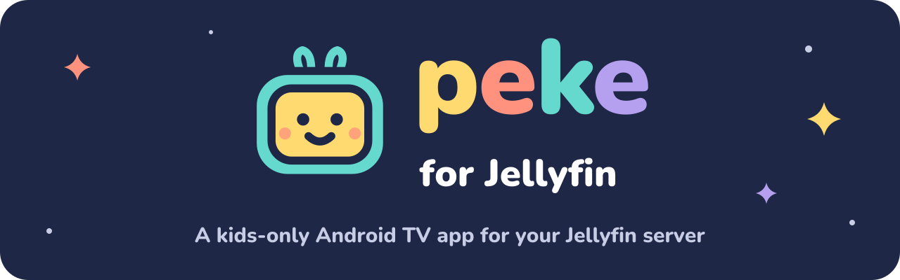

### A TV app made only for kids, run by the rules on your Jellyfin server.

**Kids get their own home, picks and channels on the big screen. Grown-ups set the rules once, on the server.**

[](https://github.com/aldoborrero/peke/actions/workflows/main.yml)
[](https://www.android.com/tv/)
[](https://jellyfin.org/)
[](LICENSE)

[Install](#install) · [What it does](#what-it-does) · [Screenshots](#screenshots) · [How it works](#how-it-works) · [Building](#building) · [Contributing](#contributing) · [Credits](#credits)

</div>

---

Peke is an Android TV app for children, for households that run their own [Jellyfin](https://jellyfin.org) server with
the [Jellyfin Kids](https://github.com/aldoborrero/jellyfin-kids) plugin. A kid picks their profile and lands on a
home with their own picks, shows and live channels, all reachable with a D-pad remote. When the time a grown-up set
runs out, Peke stops and tells the kid why.

Grown-ups use Peke only to set the TV up and watch with another Jellyfin client.

Peke is a fork of [Wholphin](https://github.com/damontecres/Wholphin) by damontecres. It keeps Wholphin's player
and much of its code, and turns it into an app for one audience: kids. Peke is not an official Jellyfin app.

> [!NOTE]
> Early development. The first release, v0.1.0, is on its way.

## Install

You need:

- an Android TV, Google TV or Fire TV device running Android 6 or later;
- a Jellyfin 12.x server with the [Jellyfin Kids](https://github.com/aldoborrero/jellyfin-kids) plugin 0.0.7.0 or
  later. Without the plugin, Peke only shows the grown-up setup screen and explains what is missing.

Peke is installed by sideloading:

1. Allow installing apps from unknown sources on the TV.
2. Download the APK for your TV from the [latest release](https://github.com/aldoborrero/peke/releases/latest):
   `Peke-armeabi-v7a.apk` for most TVs (many run 32-bit apps even on 64-bit chips), `Peke-arm64-v8a.apk` for
   64-bit ones, or `Peke.apk`, which works everywhere and is larger.
3. Install it with a file manager, the Send files to TV app, or `adb install`.

Peke checks its own GitHub releases for updates, and a grown-up installs them from Settings. Its application id is
`dev.aldoborrero.peke`, so it installs next to Wholphin or any other Jellyfin client.

## What it does

| | |
|---|---|
| **A home for each kid** | Picks, favourites, shows and films from the libraries the kid's Jellyfin account allows, plus their live TV channels when a grown-up chose some. |
| **Only what kids need** | Video only: no music, people or photo pages, no player debug options, no trailers before films and no theme music. Search and voice search appear only for kids allowed to search. |
| **Screen time from the server** | Daily allowance, time per sitting and breaks are counted by the plugin across every TV in the house. Peke shows the time left, warns before it ends and explains a stop. |
| **Parent gate** | One household code, typed with the remote's arrows or digits. It opens the kid's settings, adds time, or leaves the kids' side. |
| **Grown-up setup screen** | A grown-up profile opens a short screen: kids settings, Peke's settings, Quick Connect, the user list and licenses. It never opens browsing or playback. |
| **Direct play first** | ExoPlayer with the FFmpeg and AV1 decoders, and MPV, so most files play without server transcoding. |
| **English and Spanish** | The whole app, kids' screens included. |

## Screenshots

Peke on a 1080p Android TV emulator, in the default PekeTV theme, against a demo server with two made-up kids, Leo
and Mia. Select a picture to see it full size.

| | |
|---|---|
| [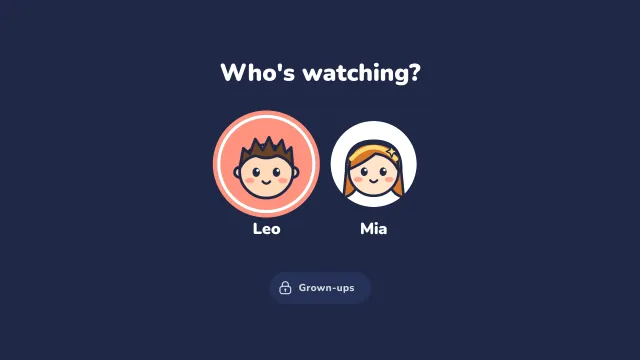](docs/assets/screenshots/kids-picker.webp)<br>Each kid finds their own face on the picker. | [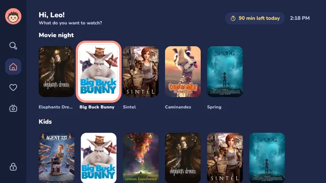](docs/assets/screenshots/home.webp)<br>Leo's home: his picks, his library and the time he has left today. |
| [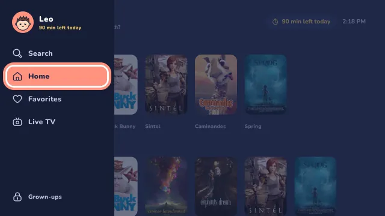](docs/assets/screenshots/home-sidebar.webp)<br>The sidebar holds search, favourites, live TV and the way in for grown-ups. | [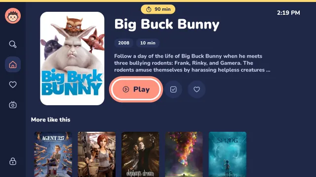](docs/assets/screenshots/film-details.webp)<br>A film's page, with Play, watched and favourite. |
| [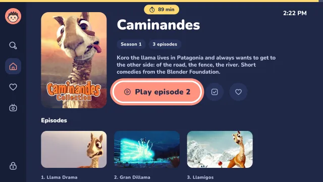](docs/assets/screenshots/season.webp)<br>A season and its episodes. | [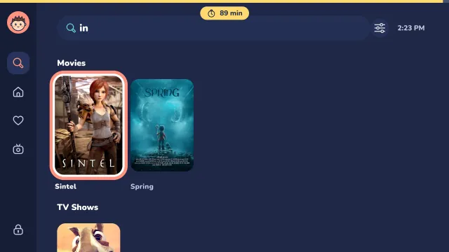](docs/assets/screenshots/search.webp)<br>Search, for kids a grown-up lets search. |
| [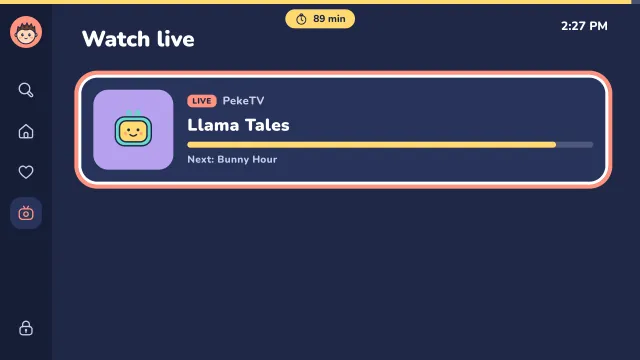](docs/assets/screenshots/live-tv.webp)<br>Live TV shows the channels a grown-up picked, with what's on now and next. | [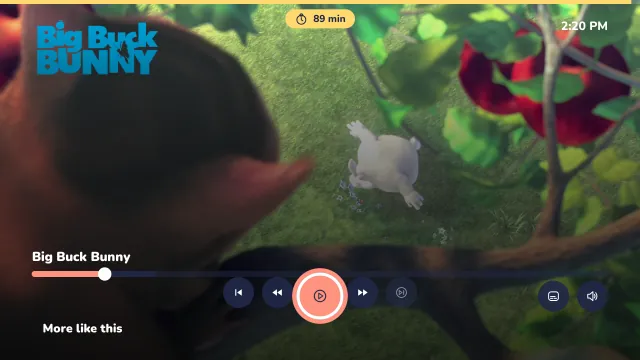](docs/assets/screenshots/player-paused.webp)<br>The player, paused. |
| [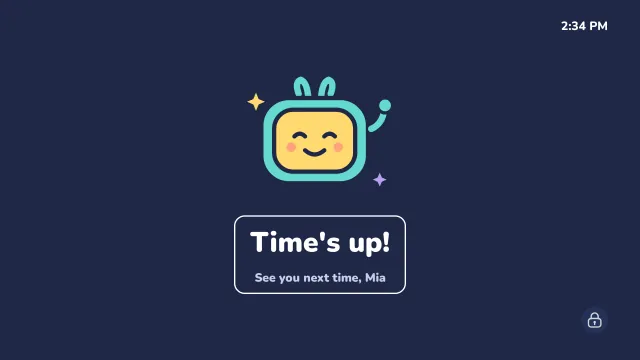](docs/assets/screenshots/times-up.webp)<br>When Mia's time runs out, the buddy says goodbye. The lock in the corner is for grown-ups. | [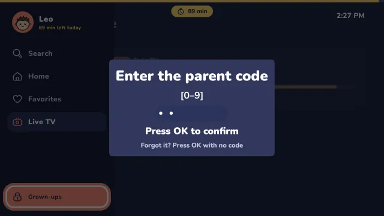](docs/assets/screenshots/parent-gate.webp)<br>The parent code, typed with the remote. |
| [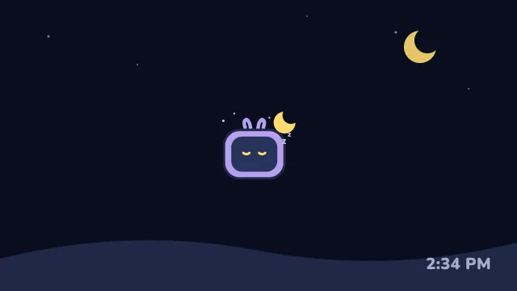](docs/assets/screenshots/screensaver.webp)<br>The screensaver. | [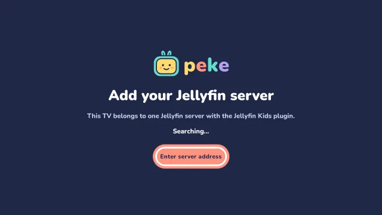](docs/assets/screenshots/setup-server.webp)<br>Setup starts with the server address. |
| [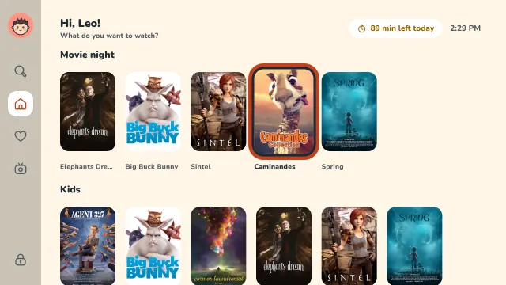](docs/assets/screenshots/home-papel-theme.webp)<br>Papel, the light theme for daytime. Mandarina and Caramelo are the other two. | |

## How it works

The server decides. Kid profiles, the parent code, the daily allowance, sitting limits, breaks, picks and live TV
channels all come from the Jellyfin Kids plugin, which counts screen time across every TV, so switching TVs doesn't
reset it. With the plugin's enforcement turned on, the server also stops kids on other Jellyfin apps. What a kid can
see comes from their Jellyfin account (libraries, parental rating, allowed hours).

Peke caches the rules for offline use and fails closed: if it can't read them, the kids' side stays locked.

## Building

Everything builds in the Nix devshell (`direnv allow`, or `nix develop`):

```sh
nix develop -c ./gradlew assembleDebug testDebugUnitTest
nix develop -c ./gradlew assembleRelease
nix fmt
```

MPV and the Media3 FFmpeg and AV1 decoders come from the
[wholphin-extensions](https://github.com/damontecres/wholphin-extensions) package feed on GitHub Packages, which
needs a GitHub token even for public packages. Create a classic personal access token with only the `read:packages`
scope and give it to Gradle, never to the repository:

```properties
# ~/.gradle/gradle.properties
WholphinExtensionsUsername=<your GitHub login>
WholphinExtensionsPassword=<classic token with read:packages>
```

You can also set `ORG_GRADLE_PROJECT_WholphinExtensionsUsername` and
`ORG_GRADLE_PROJECT_WholphinExtensionsPassword`. Debug builds work without the token, with an MPV stub and no
decoders; release builds refuse to build without it. CI reads the same values from the repository secrets
`EXTENSIONS_USERNAME` and `EXTENSIONS_PASSWORD`.

Releases are tagged `vMAJOR.MINOR.PATCH`, and the number of tags is the version code.

## Contributing

Issues and pull requests are welcome. See [CONTRIBUTING.md](CONTRIBUTING.md) for how to set up, test and format a
change, and [DEVELOPMENT.md](DEVELOPMENT.md) for how the code is laid out.

## Credits

- damontecres and the Wholphin contributors. Peke is a fork of [Wholphin](https://github.com/damontecres/Wholphin)
  and is built on its player, data layer and interface.
- The Jellyfin team for the server, and the developers of the official Jellyfin Android TV client, whose device
  direct play profile code Wholphin adapted.
- The Jellyfin Kotlin SDK developers and the authors of every library Peke uses. The license screen in the app lists
  them all.
- The Blender Foundation for the open films in the screenshots: Big Buck Bunny, Elephants Dream, Sintel, Spring,
  Cosmos Laundromat, Agent 327 and Caminandes, all licensed CC BY ([Blender Studio](https://studio.blender.org/films/)).
  Leo and Mia are made-up kids on a demo server.

## License

Peke is licensed under the GNU General Public License version 2 only, like Wholphin. See [LICENSE](LICENSE).
